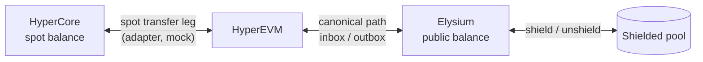
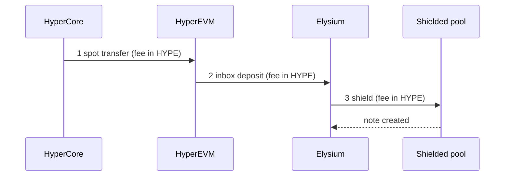
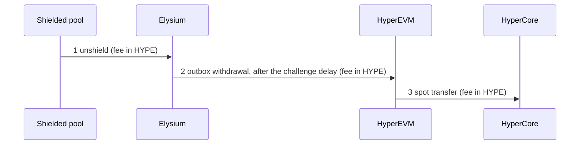
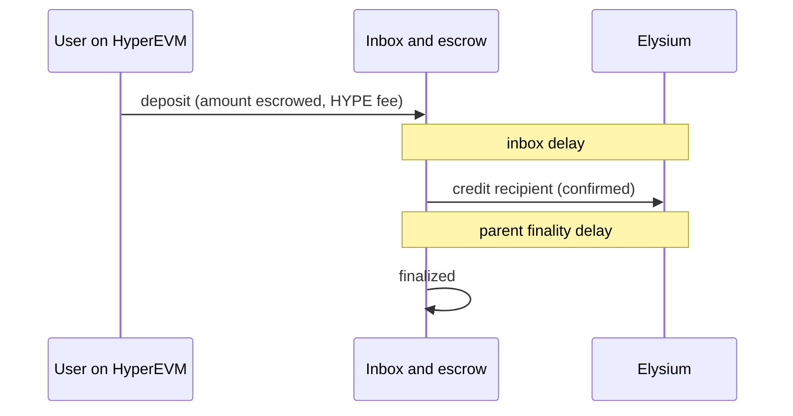
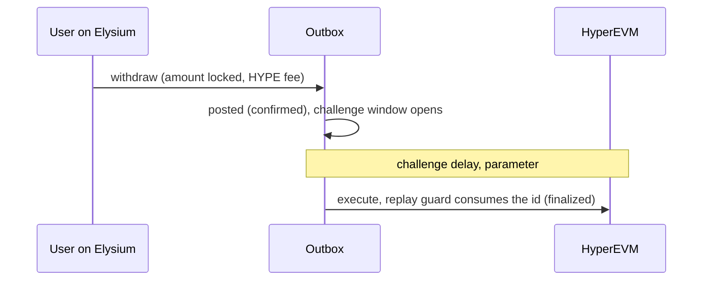
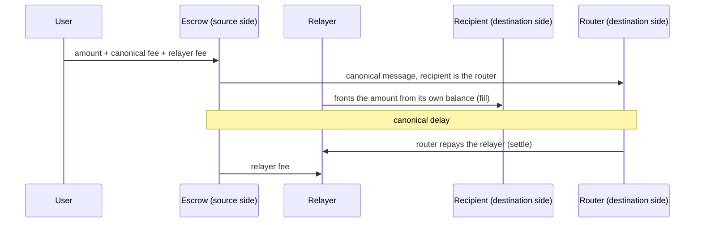

# Routes

> Research model. Not a working bridge. Delays and fees are parameters.

Value moves between three places: HyperCore (Hyperliquid), HyperEVM and Elysium. Hash Privacy lives on Elysium. Only the first and last hops of a route touch public networks that are not Elysium, and the shielded pool sits at the end of the inbound route and the start of the outbound one.

## The map



## Shield on arrival

```
Hyperliquid          HyperEVM             Elysium              Shielded pool
(spot balance)       (EVM balance)        (public balance)
     |                    |                    |                    |
     | 1 core-to-evm      |                    |                    |
     |------------------->|                    |                    |
     |   fee: HYPE        | 2 evm-to-elysium   |                    |
     |                    |  inbox deposit     |                    |
     |                    |------------------->|                    |
     |                    |   fee: HYPE        | 3 shield           |
     |                    |                    |------------------->|
     |                    |                    |   fee: HYPE        |
     |                    |                    |           note created
```



`planShieldOnArrival` produces these three hops. `from: "hyperevm"` drops hop 1 for a user who already holds funds on HyperEVM.

## Unshield and leave

```
Shielded pool        Elysium              HyperEVM             Hyperliquid
     |                    |                    |                    |
     | 1 unshield         |                    |                    |
     |------------------->|                    |                    |
     |   fee: HYPE        | 2 elysium-to-evm   |                    |
     |                    |  outbox withdrawal |                    |
     |                    |  (challenge delay) |                    |
     |                    |------------------->|                    |
     |                    |   fee: HYPE        | 3 evm-to-core      |
     |                    |                    |------------------->|
     |                    |                    |   fee: HYPE        |
```



`planUnshieldToCore` produces these three hops and needs the id of the note to spend. `to: "hyperevm"` drops hop 3.

## Fees and funding

Each hop charges its fee in HYPE on the domain where the hop starts. The plan lists `requiredHype` per domain: the HYPE the account must already hold there, on top of anything that arrives. A route that cannot pay its fees does not start. How a new user gets the first HYPE on Elysium is an open question, see [OPEN-QUESTIONS.md](OPEN-QUESTIONS.md).

## The canonical path





A deposit that is not delivered before its expiry can only be refunded. A withdrawal that is challenged inside the window returns to the sender on Elysium. Each message id can be consumed once.

## The fast path



If nobody fills, the router pays the recipient when the canonical message finalizes, and the relayer fee goes back to the user. If the canonical message fails, the escrow pays the relayer when it filled, or returns the amount to the user when it did not.

In a route, a fast hop counts as done once the relayer has filled, so the next hop starts early. Settlement of the earlier hop continues in the background.
