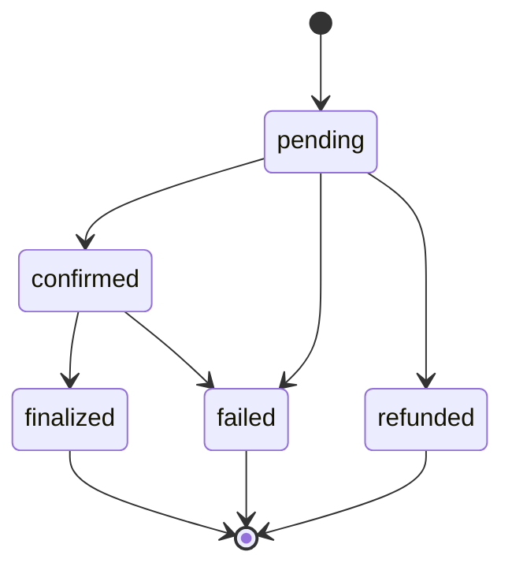

# State machines

> Research model. Not a working bridge.

## One machine for every leg

Every hop in a route, every canonical message, every spot transfer and every fast transfer uses the same five statuses.

| Status | Meaning |
| --- | --- |
| `pending` | Submitted. The amount and the fee are held at the source |
| `confirmed` | Delivered at the destination, not yet final |
| `finalized` | Final. Nothing can undo it |
| `refunded` | The value went back to the sender |
| `failed` | The attempt did not complete. The value was returned or reassigned by the rules of that leg |

Terminal statuses are `finalized`, `refunded` and `failed`. Every other pair is rejected with `InvalidTransitionError`, and `test/state.test.ts` checks all twenty five pairs.

## What each status means per leg

| Leg | pending | confirmed | finalized | refunded | failed |
| --- | --- | --- | --- | --- | --- |
| Inbox deposit | Escrowed on HyperEVM | Credited on Elysium | Parent side treats it as final | Expired, escrow returned to the refund address | Not used |
| Outbox withdrawal | Locked on Elysium | Posted, challenge window open | Executed on HyperEVM, replay guard consumed | Not used | Challenged, amount returned to the sender on Elysium |
| Spot transfer | Held at the source | Credited at the destination | Final | Not used | Rejected, amount returned to the source, fee kept |
| Shield, unshield | Queued | Note created or spent | Final | Not used | The pool call was rejected |
| Fast transfer | Opened, nobody has fronted | The recipient has the funds, by a fill or by the canonical path | Canonical message settled, relayer repaid | No relayer filled and the canonical message failed, the user got the amount back | A relayer filled and the canonical message failed, the relayer was repaid at the source |

## What moves each status

| Leg | pending to confirmed | confirmed to finalized | other |
| --- | --- | --- | --- |
| Inbox deposit | `deliverDeposit`, after the inbox delay and before the expiry | `finalizeDeposit`, after the parent finality delay | `refundDeposit` at or after the expiry |
| Outbox withdrawal | `confirmWithdrawal` | `executeWithdrawal`, after the challenge delay | `challengeWithdrawal` inside the window |
| Spot transfer | `confirm`, after the settle delay | `finalize`, after the finality delay | `fail` |
| Fast transfer | `fill`, inside the fill window | `settle`, once the canonical message is final | `settle` once the canonical message failed |

## Replay guard

`deliverDeposit`, `refundDeposit` and `executeWithdrawal` each consume the message id in a `ReplayGuard`. A second call with the same id fails with `ReplayError` before any state check. A deposit that was refunded cannot be delivered later, and a delivered deposit cannot be refunded.

## Route status

A route has its own status: `running`, `completed`, `failed` or `refunded`. It is `completed` when every hop is final. If the current hop fails, the route is `failed`. If the current hop is refunded, the route is `refunded`. `position()` says where the value sits after a stop.

A fast hop whose relayer was repaid at the source after the route had already moved on is recorded as `failed` in the hop log and does not fail the route, because the user already holds the funds.
